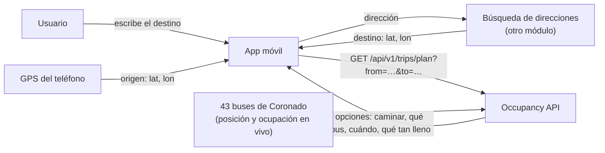
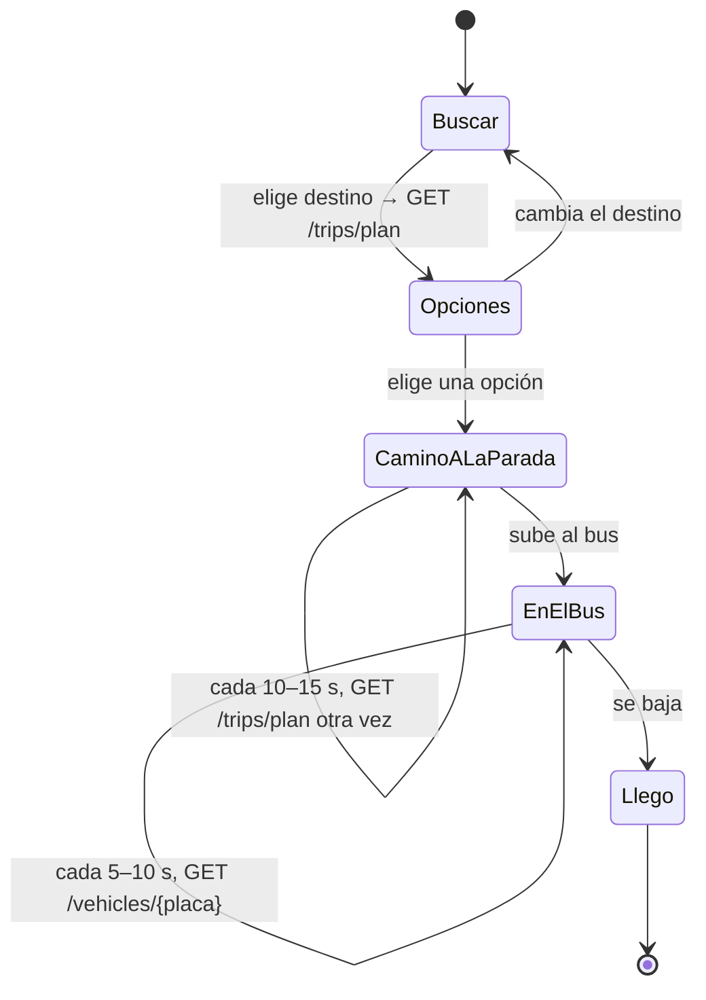
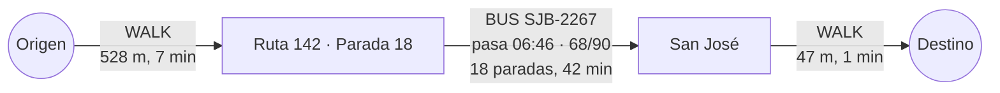

# Instrucciones: Planificador de viajes para la app cliente

**Fecha:** 6 de octubre de 2026 · **Autor:** Guillermo Jimenez

---

## 1. Qué hace el planificador

El usuario escribe **desde dónde** y **hasta dónde** quiere ir. La app le muestra **qué bus de la línea de Coronado tomar**, como lo haría Google Maps, pero con datos que Google no tiene: **cuánta gente lleva cada bus**, a qué velocidad va y si el usuario alcanza a llegar a la parada antes de que pase.

La Occupancy API hace todo el cálculo. La app solo tiene que:

1. Conseguir las coordenadas de **origen** (el GPS del teléfono) y **destino** (la búsqueda de direcciones).
2. Llamar a **un endpoint**: `GET /api/v1/trips/plan`.
3. **Mostrar** las opciones y **volver a consultar** cada 10–15 s mientras el usuario va a la parada.

**Para probarlo sin escribir código:** abra el simulador de rutas, que llama al mismo endpoint y muestra la respuesta: https://lg0618pp-002-site2.htempurl.com/simulateroute

## 2. Cómo encajan las piezas



- La **búsqueda de direcciones** (convertir "Mall San Pedro" en coordenadas) **no** es parte de la Occupancy API: la hace otro módulo. El planificador solo recibe coordenadas.
- La Occupancy API conoce las rutas, las paradas y dónde está cada bus en este momento.

## 3. El recorrido del usuario en la app



| Pantalla | Qué llama la app | Cada cuánto |
|---|---|---|
| **Opciones** | `GET /api/v1/trips/plan?from=…&to=…` | Una vez al buscar |
| **Camino a la parada** | `GET /api/v1/trips/plan` con la posición GPS **actual** | Cada 10–15 s |
| **En el bus** | `GET /api/v1/vehicles/{placa}` del bus elegido | Cada 5–10 s |

## 4. La llamada

```
GET https://lg0618pp-002-site2.htempurl.com/api/v1/trips/plan?from=9.9620,-84.0300&to=9.9330,-84.0790
```

| Parámetro | Obligatorio | Por defecto | Qué es |
|---|---|---|---|
| `from` | sí | | Origen como `lat,lon`: el GPS del teléfono |
| `to` | sí | | Destino como `lat,lon`: el resultado de la búsqueda de direcciones |
| `walkKmh` | no | `4.5` | Velocidad al caminar, de 1 a 8 |
| `maxWalkMeters` | no | `1000` | Lo máximo que el usuario camina hasta una parada, de 100 a 3000 |
| `marginSeconds` | no | `60` | Cuánto antes que el bus debe llegar el usuario a la parada, de 0 a 600 |

- No necesita llave ni encabezados especiales.
- Las coordenadas van con **punto decimal** y separadas por **coma**, sin espacios: `9.9620,-84.0300`.
- Pruébelo en el navegador: pegue la dirección de arriba y verá el JSON.

## 5. La respuesta

Una respuesta real (Ipís → centro de San José), recortada:

```json
{
  "from": { "lat": 9.962, "lon": -84.03 },
  "to": { "lat": 9.933, "lon": -84.079 },
  "generatedAt": "2026-10-06T06:37:41Z",
  "message": null,
  "options": [
    {
      "departAt": "2026-10-06T06:37:41Z",
      "arriveAt": "2026-10-06T07:29:23Z",
      "durationMinutes": 51.7,
      "transfers": 0,
      "warnings": [],
      "legs": [
        {
          "type": "WALK",
          "from": { "name": "Origen", "lat": 9.962, "lon": -84.03, "stopId": null },
          "to": { "name": "Ruta 142 · Parada 18", "lat": 9.964298, "lon": -84.032894, "stopId": "R142-18" },
          "departAt": "2026-10-06T06:37:41Z", "arriveAt": "2026-10-06T06:44:43Z",
          "minutes": 7, "meters": 528, "bus": null
        },
        {
          "type": "BUS",
          "from": { "name": "Ruta 142 · Parada 18", "lat": 9.964298, "lon": -84.032894, "stopId": "R142-18" },
          "to": { "name": "San José", "lat": 9.932732, "lon": -84.079187, "stopId": "R142-00" },
          "departAt": "2026-10-06T06:46:27Z", "arriveAt": "2026-10-06T07:28:45Z",
          "minutes": 42.3, "meters": 7262,
          "bus": {
            "routeId": "R142", "routeName": "Ruta 142", "direction": "INBOUND", "headsign": "San José",
            "vehicleId": "SJB-2267", "waitMinutes": 1.7, "stops": 18,
            "vehicle": {
              "location": { "lat": 9.966079, "lon": -84.019441 },
              "speedKmh": 15, "headingDeg": 273.9,
              "passengerCount": 68, "capacity": 90, "percent": 76, "status": "FEW_SEATS_AVAILABLE",
              "distanceToStopMeters": 1554
            },
            "laterBuses": [
              { "vehicleId": "SJB-12726", "arriveAt": "2026-10-06T06:51:27Z", "passengerCount": 86, "capacity": 90, "status": "CRUSHED_STANDING_ROOM_ONLY" },
              { "vehicleId": "SJB-10356", "arriveAt": "2026-10-06T06:55:59Z", "passengerCount": 50, "capacity": 90, "status": "FEW_SEATS_AVAILABLE" }
            ],
            "path": [ { "lat": 9.964298, "lon": -84.032894 }, { "lat": 9.964296, "lon": -84.0331 } ]
          }
        },
        {
          "type": "WALK",
          "from": { "name": "San José", "lat": 9.932732, "lon": -84.079187, "stopId": "R142-00" },
          "to": { "name": "Destino", "lat": 9.933, "lon": -84.079, "stopId": null },
          "departAt": "2026-10-06T07:28:45Z", "arriveAt": "2026-10-06T07:29:23Z",
          "minutes": 0.6, "meters": 47, "bus": null
        }
      ]
    }
  ]
}
```

### Cómo leerla

Cada **opción** es una forma de llegar, y está hecha de **tramos** (`legs`) en orden:



| Campo | Qué mostrar |
|---|---|
| `options` | Las opciones, **la mejor primero**. Puede venir vacía: entonces lea `message` |
| `message` | Por qué no hay opciones (sin servicio, fuera de cobertura, etc.). Muéstrelo tal cual |
| `durationMinutes`, `arriveAt` | "52 min · llega 01:29" |
| `transfers` | `0` = directo, `1` = cambia de bus en la Terminal de Coronado |
| `warnings` | Avisos ya escritos en español ("El bus SJB-… viene lleno…"). Muéstrelos tal cual |
| `legs[].type` | `WALK` (caminar) o `BUS` |
| `legs[].from.name`, `to.name` | Nombres de lugares y paradas |
| `legs[].departAt` | En un `BUS`: **la hora en que el bus pasa por la parada** |
| `bus.vehicleId` | **La placa del bus que hay que tomar** |
| `bus.routeName`, `bus.headsign` | "Ruta 142 hacia San José": lo que dice el rótulo del bus |
| `bus.waitMinutes` | Cuánto espera el usuario en la parada |
| `bus.stops` | Cuántas paradas recorre hasta bajarse |
| `bus.vehicle` | El bus **ahora**: dónde está, velocidad, dirección, pasajeros y nivel de ocupación |
| `bus.vehicle.distanceToStopMeters` | Cuánto le falta al bus para llegar a la parada |
| `bus.laterBuses` | Los siguientes buses por esa parada, por si el primero viene lleno |
| `bus.path` | El recorrido del tramo en bus, para dibujarlo en el mapa |

Las horas vienen en **UTC**: muéstrelas en hora de Costa Rica (ver el código del punto 6).

Los niveles de ocupación (`status`) y sus colores sugeridos:

| `status` | Mostrar | Color |
|---|---|---|
| `EMPTY` | Vacío | verde |
| `MANY_SEATS_AVAILABLE` | Muchos asientos | verde claro |
| `FEW_SEATS_AVAILABLE` | Pocos asientos | amarillo |
| `STANDING_ROOM_ONLY` | Solo de pie | naranja |
| `CRUSHED_STANDING_ROOM_ONLY` | Muy lleno | rojo |
| `FULL` | Lleno | rojo oscuro |

## 6. El código (TypeScript / React Native)

### 6.1 Los tipos

Cópielos en un archivo, por ejemplo `src/api/tripPlan.ts`:

```ts
export type OccupancyStatus =
  | 'EMPTY' | 'MANY_SEATS_AVAILABLE' | 'FEW_SEATS_AVAILABLE'
  | 'STANDING_ROOM_ONLY' | 'CRUSHED_STANDING_ROOM_ONLY' | 'FULL'

export interface GeoPoint { lat: number; lon: number }

export interface TripPlace { name: string; lat: number; lon: number; stopId: string | null }

export interface BusRide {
  routeId: string
  routeName: string
  direction: 'INBOUND' | 'OUTBOUND'
  headsign: string
  vehicleId: string
  waitMinutes: number
  stops: number
  vehicle: {
    location: GeoPoint
    speedKmh: number | null
    headingDeg: number | null
    passengerCount: number | null
    capacity: number | null
    percent: number | null
    status: OccupancyStatus | null
    distanceToStopMeters: number
  }
  laterBuses: { vehicleId: string; arriveAt: string; passengerCount: number | null; capacity: number | null; status: OccupancyStatus | null }[]
  path: GeoPoint[]
}

export interface TripLeg {
  type: 'WALK' | 'BUS'
  from: TripPlace
  to: TripPlace
  departAt: string
  arriveAt: string
  minutes: number
  meters: number
  bus: BusRide | null
}

export interface TripOption {
  departAt: string
  arriveAt: string
  durationMinutes: number
  transfers: number
  legs: TripLeg[]
  warnings: string[]
}

export interface TripPlan {
  from: GeoPoint
  to: GeoPoint
  generatedAt: string
  options: TripOption[]
  message: string | null
}
```

### 6.2 La llamada

```ts
// La URL base va en la configuración de la app, no fija en el código.
const API = 'https://lg0618pp-002-site2.htempurl.com'

export async function planTrip(from: GeoPoint, to: GeoPoint): Promise<TripPlan> {
  const point = (p: GeoPoint) => `${p.lat.toFixed(6)},${p.lon.toFixed(6)}`
  const response = await fetch(`${API}/api/v1/trips/plan?from=${point(from)}&to=${point(to)}`)
  if (!response.ok) {
    // Los errores vienen en formato Problem Details; "title" explica qué pasó.
    const problem = await response.json().catch(() => null)
    throw new Error(problem?.title ?? `HTTP ${response.status}`)
  }
  return response.json()
}

// Las horas llegan en UTC; así se muestran en hora de Costa Rica.
export function horaLocal(iso: string) {
  return new Date(iso).toLocaleTimeString('es-CR', { hour: '2-digit', minute: '2-digit', hour12: false, timeZone: 'America/Costa_Rica' })
}
```

### 6.3 Consultar mientras el usuario va a la parada

El plan cambia porque los buses se mueven y el usuario camina. Este *hook* vuelve a pedir el plan cada 15 s con la **posición actual**, sin solapar consultas, y se pausa cuando la app pasa a segundo plano:

```ts
import { useEffect, useRef, useState } from 'react'
import { AppState } from 'react-native'

export function useTripPlan(from: GeoPoint | null, to: GeoPoint | null, everyMs = 15_000) {
  const [plan, setPlan] = useState<TripPlan | null>(null)
  const [error, setError] = useState<string | null>(null)
  const latest = useRef({ from, to })
  latest.current = { from, to }

  useEffect(() => {
    if (!from || !to) return
    let stopped = false
    let timer: ReturnType<typeof setTimeout> | undefined

    async function tick() {
      const { from, to } = latest.current
      if (from && to && AppState.currentState === 'active') {
        try {
          setPlan(await planTrip(from, to))
          setError(null)
        } catch (e) {
          setError((e as Error).message) // se conserva el último plan en pantalla
        }
      }
      if (!stopped) timer = setTimeout(tick, everyMs) // la siguiente, solo después de la respuesta
    }

    tick()
    return () => { stopped = true; clearTimeout(timer) }
  }, [from?.lat, from?.lon, to?.lat, to?.lon, everyMs])

  return { plan, error }
}
```

`from` es la posición GPS del teléfono (por ejemplo con `expo-location` o `react-native-geolocation`), y `to` el destino que devolvió la búsqueda de direcciones.

### 6.4 Mostrar una opción

```tsx
function OpcionDeViaje({ option }: { option: TripOption }) {
  return (
    <View>
      <Text>{Math.round(option.durationMinutes)} min · llega {horaLocal(option.arriveAt)}
        {option.transfers ? ' · 1 transbordo' : ' · directo'}</Text>

      {option.legs.map((leg, i) => leg.type === 'WALK'
        ? <Text key={i}>🚶 Camine {leg.meters} m ({Math.round(leg.minutes)} min) hasta {leg.to.name}</Text>
        : <Text key={i}>
            🚌 {leg.bus!.routeName} hacia {leg.bus!.headsign}: bus {leg.bus!.vehicleId}{' '}
            pasa a las {horaLocal(leg.departAt)} · {leg.bus!.vehicle.passengerCount}/{leg.bus!.vehicle.capacity}{' '}
            · baje en {leg.to.name}
          </Text>)}

      {option.warnings.map((w, i) => <Text key={`w${i}`}>⚠ {w}</Text>)}
    </View>
  )
}
```

Así puede verse en pantalla:

```
┌──────────────────────────────────────────────┐
│ 52 min · llega 01:29 · directo               │
│ 🚶 Camine 528 m (7 min) hasta Ruta 142 · P18 │
│ 🚌 Ruta 142 hacia San José: bus SJB-2267     │
│    pasa a las 00:46 · 68/90 Pocos asientos   │
│    18 paradas · baje en San José             │
│    Después: SJB-12726 00:51 (muy lleno)      │
│ 🚶 Camine 47 m (1 min) hasta su destino      │
└──────────────────────────────────────────────┘
```

### 6.5 Dibujarla en el mapa (opcional)

Con `react-native-maps`, el tramo en bus se dibuja con `bus.path` y los tramos a pie como una línea punteada:

```tsx
import MapView, { Marker, Polyline } from 'react-native-maps'

const toLatLng = (p: GeoPoint) => ({ latitude: p.lat, longitude: p.lon })

{option.legs.map((leg, i) => leg.type === 'BUS'
  ? <Polyline key={i} coordinates={leg.bus!.path.map(toLatLng)} strokeColor="#1f6feb" strokeWidth={5} />
  : <Polyline key={i} coordinates={[toLatLng(leg.from), toLatLng(leg.to)]} strokeColor="#667085" lineDashPattern={[6, 6]} />)}

{/* Dónde está ahora el bus recomendado */}
{option.legs.filter(l => l.bus).map((leg, i) =>
  <Marker key={`bus${i}`} coordinate={toLatLng(leg.bus!.vehicle.location)} title={leg.bus!.vehicleId} />)}
```

### 6.6 Seguir el bus elegido

Cuando el usuario ya va en el bus, deje de pedir el plan y siga al bus por su placa:

```ts
const res = await fetch(`${API}/api/v1/vehicles/${encodeURIComponent(vehicleId)}`)
const bus = await res.json() // location, occupancy, trip, stale…
```

Cada 5–10 s, mueva el marcador a `bus.location`. Si `bus.stale` es `true`, el bus dejó de reportar: muéstrelo en gris.

## 7. Casos especiales

| Situación | Qué llega | Qué hacer |
|---|---|---|
| De noche (11 p. m. a 5 a. m.) | `options: []` y `message` "No hay buses … en servicio" | Mostrar el mensaje |
| Origen o destino lejos de la línea | `options: []` y `message` "El origen está a más de 1000 m…" | Mostrar el mensaje; ofrecer cambiar el destino |
| Muy cerca | Una opción con un solo tramo `WALK` | "Le conviene caminar" |
| Bus lleno | Un aviso en `warnings` y otros buses en `laterBuses` | Mostrar el aviso y el siguiente bus |
| Margen ajustado | Aviso "Margen ajustado…" | Sugerir apurarse o tomar el siguiente bus |
| El usuario no llegó a tiempo | En la siguiente consulta, otro `vehicleId` | Actualizar la pantalla: el plan nuevo ya lo considera |
| Coordenadas mal escritas | `400` con `title` | Revisar el formato `lat,lon` |
| Sin red o API caída | Error de red | Conservar el último plan y avisar |
| La primera consulta tarda | El servidor de demostración estaba dormido | Mostrar "Cargando…", no un error |

## 8. Probar

1. **Sin código:** el simulador de rutas trae 10 ejemplos y muestra la respuesta tal cual: https://lg0618pp-002-site2.htempurl.com/simulateroute
2. **En el navegador:** https://lg0618pp-002-site2.htempurl.com/api/v1/trips/plan?from=9.9620,-84.0300&to=9.9330,-84.0790
3. **Coordenadas de ejemplo** sobre la línea de Coronado:

| Lugar | `lat,lon` |
|---|---|
| Centro de San José | `9.9330,-84.0790` |
| Guadalupe | `9.9480,-84.0560` |
| Ipís | `9.9620,-84.0300` |
| Terminal de Coronado | `9.9761,-84.0073` |
| Dulce Nombre | `9.9843,-84.0154` |
| Las Nubes | `9.9882,-83.9605` |
| Cascajal | `10.0377,-83.9298` |
| Patalillo | `9.9735,-84.0264` |

## Notas

- Los datos son **simulados**: 43 buses de Autobuses Unidos de Coronado en la Ruta 142 y 10 ramales, con paradas cada ~400 m. La forma de la respuesta no va a cambiar cuando lleguen datos reales.
- Los buses simulados solo circulan de **5 a. m. a 11 p. m.**, hora de Costa Rica.
- Las horas de paso son **estimaciones**: velocidad típica según la hora, 20 s por parada y 5 min de descanso en cada terminal.
- La documentación completa de la API está en `src/Innova.Occupancy.Api/README.md`.
