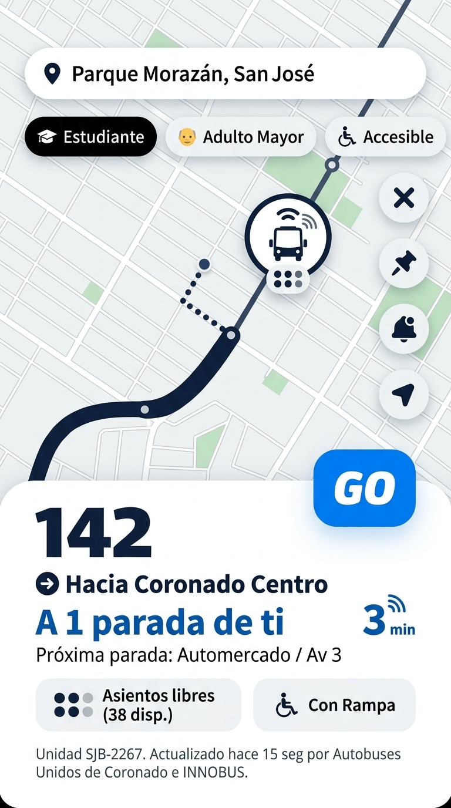
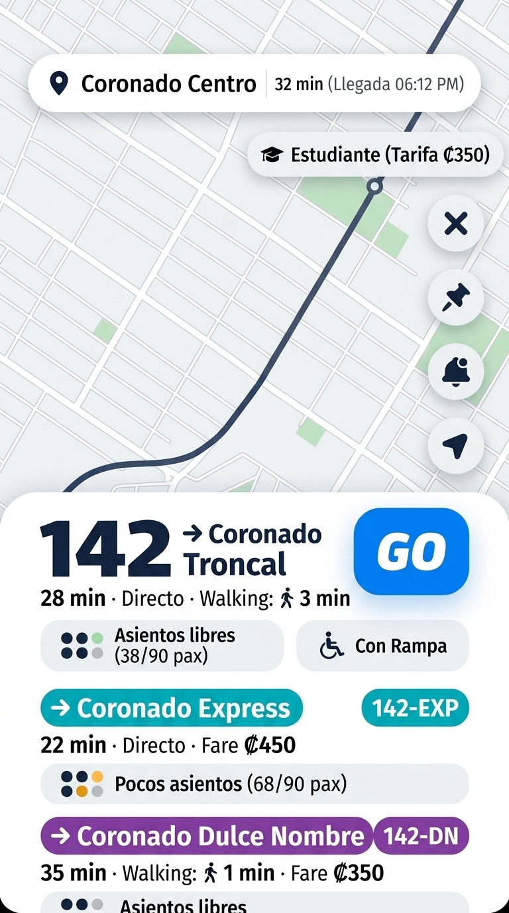
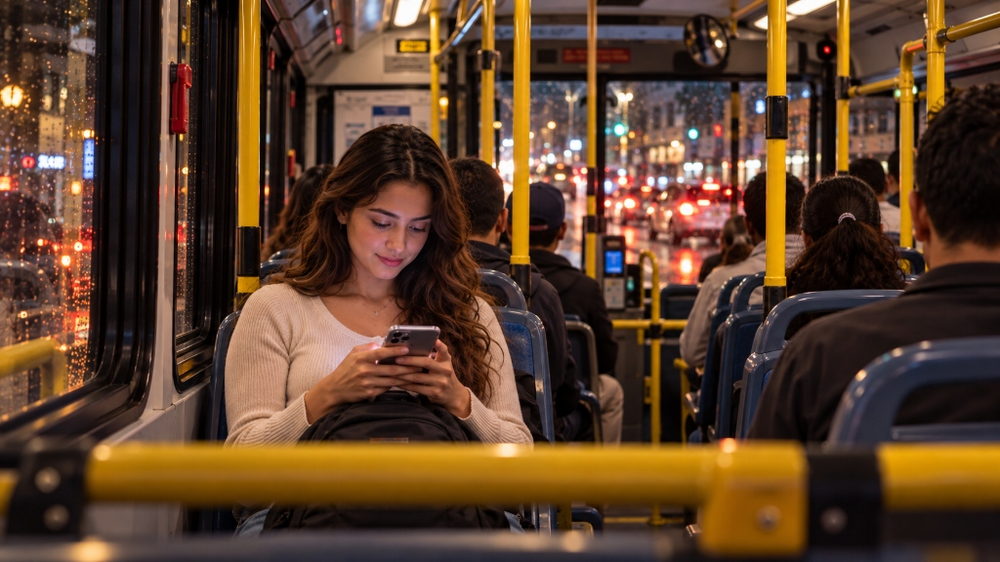
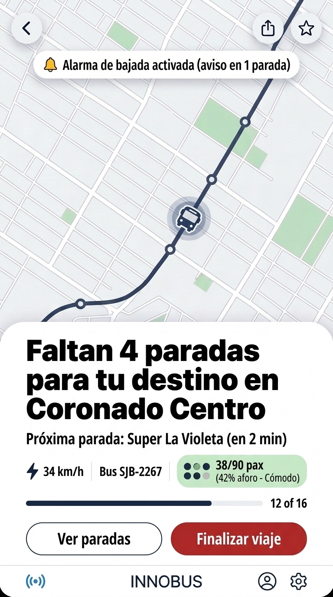

# Storyboard & Guión Narrativo: El Viaje de Sofía en la Ruta 142 con INNOBUS

> **Línea de Transporte:** Ruta 142 (San José – Coronado) y ramales de Coronado (Autobuses Unidos de Coronado).  
> **Protagonista:** Sofía, estudiante universitaria.  
> **Contexto:** Tarde josefina de hora pico (5:30 PM), calles saturadas y necesidad de llegar a Coronado.  
> **Enfoque Visual:** Basado 100% en los lugares y autobuses reales de Costa Rica.

---

## Galería de Referencias Auténticas de la Historia

A continuación se presentan las imágenes reales que anclan visualmente cada escena:

### 1. Las Calles de San José en Hora Pico (Escena 1A)

### 2. El Parque Morazán y Templo de la Música Real (Referencia y Escena 1B)

### 3. El Autobús Real de la Ruta 142 de Coronado (Referencia y Escena 4)
*Unidad CAIO Apache de Autobuses Unidos de Coronado con rótulo LED "CORONADO", franja ondulada azul/magenta y rótulo "San José RUTA 142":*  

### 4. La Iglesia Real de Coronado al Atardecer (Referencia y Escena 6)
*La imponente catedral neogótica de San Isidro de Coronado al caer la tarde:*  

---

## Guión Escena por Escena

### Escena 1: Hora Pico Josefina en el Parque Morazán
* **Visual / Cámara:**
  1. **Toma de Establecimiento (Escena 1A):** Gran angular de la Avenida josefina en colapso total de hora pico (`scene1a_rush_hour_presa_sanjose.jpg`). Taxis rojos josefinos (`SJ-3287`), el bus de Coronado atascado en la fila, luces de freno rojas incandescentes reflejadas sobre el asfalto mojado, y comercios como Farmacia Fischel y Monge iluminando el atardecer.
  2. **Plano Medio (Escena 1B):** Corte a Sofía en la explanada del Parque Morazán (`scene1_sofia_parque_morazan.jpg`), con su mochila al hombro y celular en mano, mirando con preocupación la magnitud del congestionamiento. Al fondo, el **Templo de la Música** y la torre de cristal del Hotel Aurola.
* **Imágenes Principales de la Escena:**  
    
  
* **Audio:** Murmullo ensordecedor de ciudad, motores, bocinas y paso de carros en la presa josefina. Música de tensión reflexiva.
* **Voz en Off:**  
  *"5:30 de la tarde. Las avenidas de San José colapsan en la clásica presa de hora pico... Sofía necesita regresar a su casa en Coronado en la Ruta 142, pero el tráfico está paralizado y las paradas se desbordan."*

---

### Escena 2: Sofía Abre INNOBUS en un Día de Presas
* **Visual / Cámara:** Sofía saca su celular y abre **INNOBUS**.
  - La pantalla fija su posición: **`📍 Estás aquí (Parque Morazán)`**.
  - Sofía selecciona su perfil **`🎓 Estudiante`** y escribe **`Destino: Coronado Centro`**.
  - La app le informa que la parada de la Ruta 142 está a solo 120 metros caminando.
* **Imagen en Pantalla:**  
  
* **Audio:** Toque táctil (*haptic click*) al abrir la app.
* **Voz en Off:**  
  *"En lugar de hacer fila a ciegas en la parada, Sofía abre INNOBUS. Con su ubicación en vivo en el Parque Morazán y su tarifa de estudiante seleccionada, la app analiza las opciones de la Ruta 142 en tiempo real."*

---

### Escena 3: El Algoritmo Ofrece las 3 Mejores Rutas y Aforo en Vivo
* **Visual / Cámara:** La app despliega las **3 mejores rutas**:
  - Opción 1: **Ruta 142 Troncal** (28 min · `₡350` · **`🟢 Asientos libres: 38/90 pax`** en la unidad `SJB-2267` que pasa en **3 minutos**).
  - La app le advierte que el bus express viene saturado (`68 pax`), por lo que tomar esta unidad es la decisión perfecta.
* **Imagen en Pantalla:**  
  
* **Voz en Off:**  
  *"INNOBUS le muestra exactamente cuántos asientos libres trae cada unidad de Coronado antes de que llegue. Sofía elige la Ruta 142 Troncal, sabiendo que subirá a un bus cómodo y con asiento asegurado."*
* **Acción:** Presiona **`Seleccionar esta ruta`**.

---

### Escena 4: Abordando el Autobús Real de Coronado
* **Visual / Cámara:** Sofía camina tranquilamente a la parada. En el minuto exacto marcado por la app, llega el auténtico autobús blanco y azul de Coronado con rótulo **`CORONADO · RUTA 142`** y franjas magenta/azul. Las puertas de la unidad CAIO Apache de Autobuses Unidos de Coronado se abren y Sofía sube con un pie en el escalón y su celular en mano.
* **Imagen Principal de la Escena:**  
  
* **Audio:** Sonido del motor diésel y frenos de aire del bus de Coronado al detenerse en la parada.
* **Voz en Off:**  
  *"Cero estrés de espera. El autobús de Coronado llega en el minuto exacto previsto por la app."*

---

### Escena 5: Viaje Cómodo en Ruta 142 con Aviso de Bajada
* **Visual / Cámara:**
  - Sofía sentada cómodamente junto a la ventana mientras el bus avanza rumbo a Guadalupe y Coronado.
  - La app en su mano muestra el modo **A Bordo**: velocímetro, aforo en 42% y el aviso automático: **`🔔 Faltan 4 paradas para tu destino en Coronado`**.
* **Imágenes en Pantalla:**  
    
  
* **Audio:** Notificación suave de campana (*chime*) en el teléfono.
* **Voz en Off:**  
  *"El sistema acompaña todo el trayecto y le notifica con una alarma previa antes de su destino, permitiéndole viajar tranquila sin temor a pasarse de parada."*

---

### Escena 6: Llegada a Coronado — Iglesia San Isidro Labrador
* **Visual / Cámara:** Sofía desciende del autobús frente al parque central de Coronado y camina por la explanada de adoquines con una sonrisa tranquila y aliviada. Al fondo se eleva majestuosa la auténtica **Iglesia de San Isidro de Coronado** iluminada por reflectores cálidos bajo los colores anaranjados y violetas del cielo nocturno (`scene6_sofia_coronado_arrival.jpg`).
* **Imagen Principal de la Escena:**  
  
* **Cierre Gráfico:**  
  **INNOBUS**  
  *Monitoreo 5G en Tiempo Real · Ruta 142 Coronado*  
  *Hackatón Centroamericano de Innovación*
* **Voz en Off:**  
  *"Llegó a Coronado a tiempo, sentada y segura. Así se transforma el transporte público con INNOBUS."*
